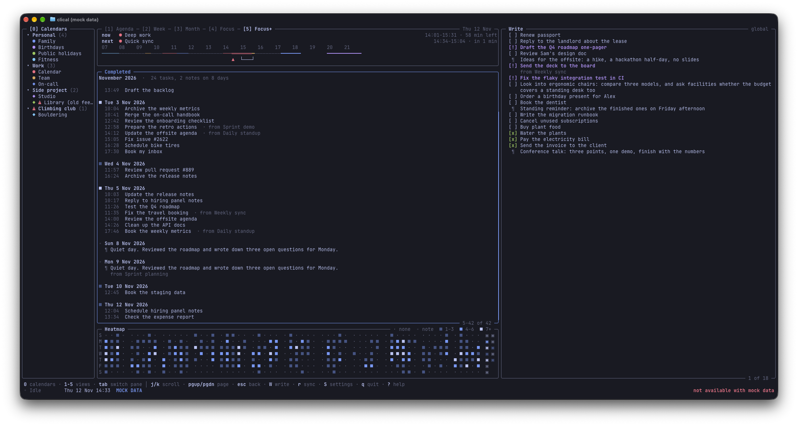
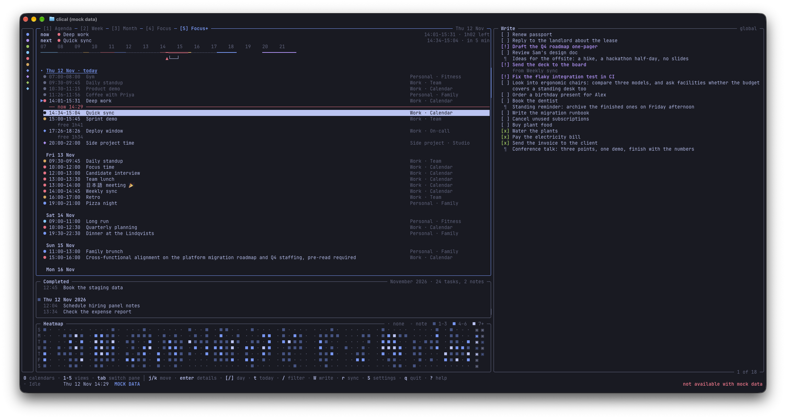
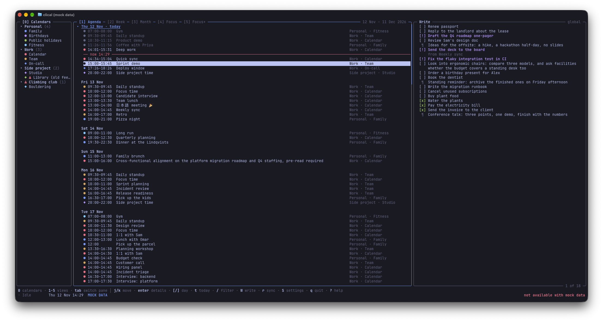
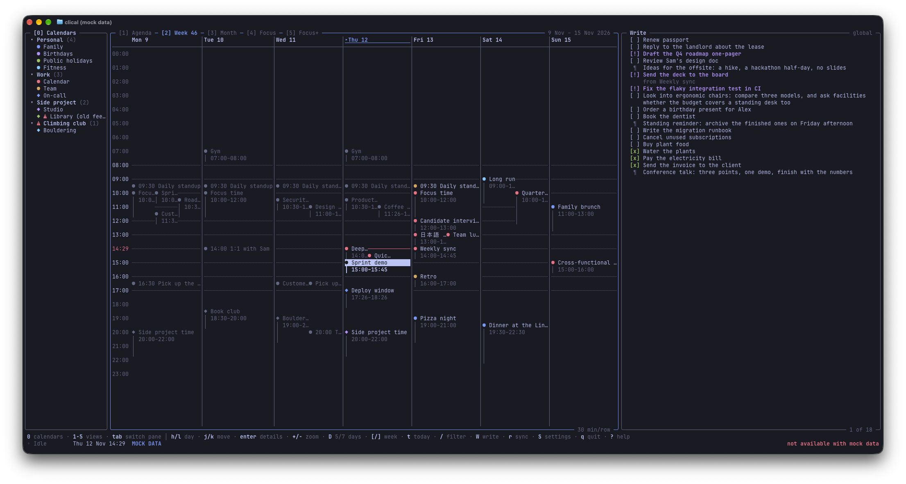
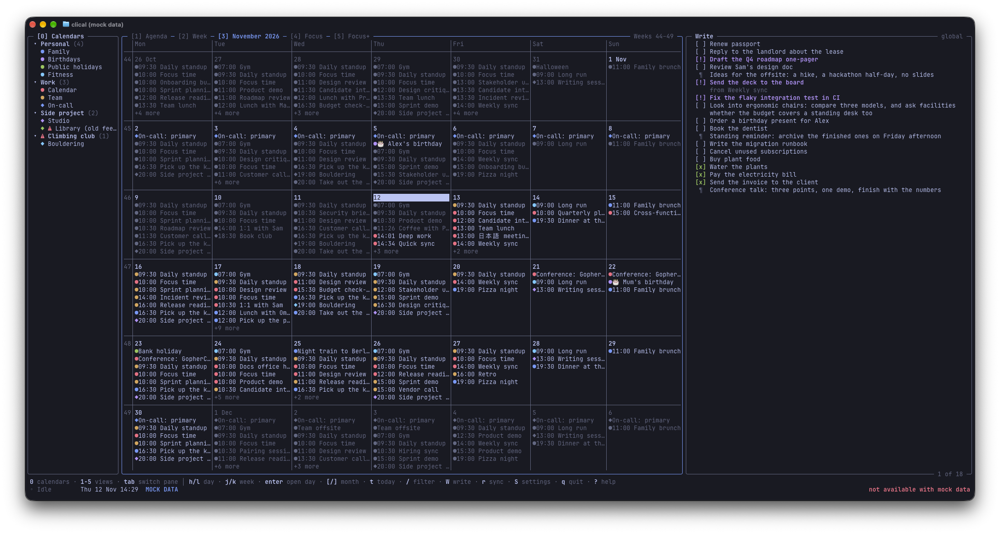
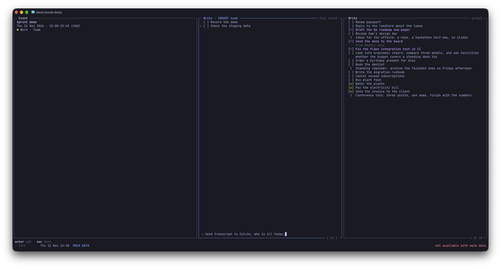

# Screenshots

CLIcal running on the made-up calendars of `clical --mock`, in a terminal
about 220 columns wide. It uses only your terminal's own 16 colors, so it
takes on your theme. Click a screenshot to see it at full size.

Back to the [README](../README.md).

## Focus+, with the completed tasks

What's on now and next and a strip of the day stay at the top while you look
back: a month of completed tasks, picked in the heatmap along the bottom. The
Write panel on the right holds your tasks and notes.

## Focus+, with today

A view to keep open all day: what's on now and how long is left, what's next
and when, the day as a strip, and the agenda from today with titles in full
and the free time between events.

## Agenda

## Week

## Month

## An event, with its own Write panel

Each event has its own tasks and notes beside its details, next to the
global Write panel.
